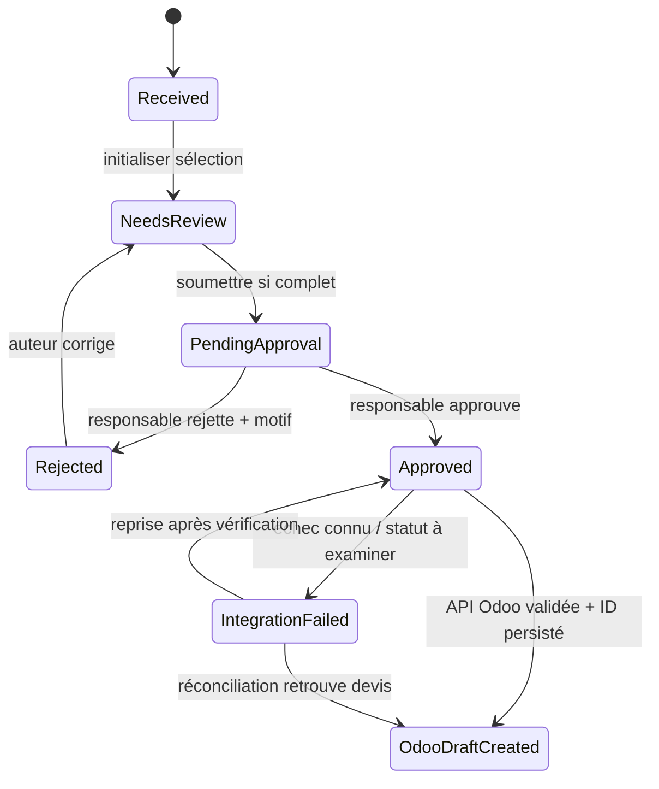

# 07 — Règles métier, RBAC, états et décisions

## 1. Langage métier partagé

- **Demande QuoteFlow** : texte reçu/introduit par le commercial + client Odoo + lignes de produits.
- **Ligne** : produit Odoo identifié + quantité + libellé original, confirmation utilisateur.
- **Approbation** : autorisation explicite d'initier la création du devis brouillon dans Odoo.
- **Devis Odoo** : objet `sale.order` encore au stade devis/brouillon (pas une commande confirmée).
- **Événement d'audit** : entrée immuable sur acteur, action, date et motif éventuel.
- **Travail d'intégration** : tâche persistée qui appelle Odoo hors transaction locale.

## 2. RBAC (contrôle serveur obligatoire)

| Opération | Commercial | Responsable commercial | Admin |
|---|---|---|---|
| Voir/créer/modifier ses propres demandes éditables | Oui | Oui, sur ses demandes | Non par défaut |
| Voir toutes les demandes commerciales | Non | Oui | Non par défaut |
| Chercher clients/produits dans Odoo | Oui | Oui | Non par défaut |
| Soumettre sa demande | Oui | Oui | Non |
| Approuver/rejeter la demande d'un autre utilisateur | Non | Oui | Non |
| Approuver sa propre demande | Non | **Non** (séparation des tâches MVP) | Non |
| Rejouer un traitement après réconciliation | Non | Non | Oui (action journalisée) |
| Configurer secrets et intégration, comptes et rôles | Non | Non | Oui |
| Déclencher directement création d'un devis via endpoint public | Non | Non | Non |

**Important** : manager peut créer une demande, mais ne peut pas auto-approuver sa propre demande ; pour les essais utiliser au moins un compte commercial et un responsable distinct. L'administrateur technique ne voit pas par défaut les textes complets des demandes. Les vérifications de propriétaire s'appliquent à chaque objet récupéré, pas seulement à la liste.

## 3. Règles métier atomiques

| ID | Règle |
|---|---|
| BR-01 | Toute demande a exactement un propriétaire QuoteFlow et une date de création. |
| BR-02 | Le client sélectionné doit correspondre à un identifiant Odoo `res.partner` existant et autorisé. |
| BR-03 | Une ligne exige un produit Odoo identifié, une quantité > 0 et une confirmation manuelle. |
| BR-04 | Une demande ne peut être soumise sans client et au moins une ligne confirmée. |
| BR-05 | Seul son propriétaire peut modifier une demande en `Received`, `NeedsReview` ou `Rejected`. |
| BR-06 | Les demandes `PendingApproval`, `Approved` ou `OdooDraftCreated` ne sont plus éditables. |
| BR-07 | Seul un responsable distinct de l'auteur peut approuver ou rejeter. |
| BR-08 | Le rejet exige un motif non vide et permet une correction puis une nouvelle soumission. |
| BR-09 | Une approbation change l'état et crée un job persistant dans **une transaction PostgreSQL**. |
| BR-10 | Odoo est source de vérité pour clients, produits, prix/taxes et devis. |
| BR-11 | La création technique cible exclusivement un devis brouillon ; aucun envoi, confirmation, facturation ni stock depuis QuoteFlow. |
| BR-12 | Une demande approuvée doit produire au maximum un devis brouillon Odoo lié, ou un état exigeant investigation. |
| BR-13 | Toute transition enregistre acteur, action, date et motif pertinent. |
| BR-14 | En cas de produit/prix/taxe modifiés côté Odoo après la revue, le traitement ne doit pas substituer silencieusement une proposition différente. Toute divergence significative impose une nouvelle validation selon politique décidée. |
| BR-15 | Le succès de création requiert une preuve de l'ID Odoo retourné puis sauvegardé localement. |
| BR-16 | Après timeout dont on ignore l'issue, ne **jamais réessayer aveuglément** une création; mettre en attente de réconciliation. |
| BR-17 | Les propositions de l'IA ne sont jamais autoritaires; aucun prix ou référence imaginée par l'IA n'entre directement dans le devis. |
| BR-18 | Une action répétée/double clic ne doit pas déclencher plusieurs approbations ou plusieurs jobs actifs pour la même demande. |
| BR-19 | L'API expose des messages sûrs, pas des secrets Odoo ou traces internes. |
| BR-20 | Les IDs Odoo ne sont pas des IDs de demandes QuoteFlow et ne remplacent pas les identifiants UUID locaux. |

**Décision ouverte BR-14** : définir avec l'utilisateur comment gérer une variation de prix/taxe avant création (solution simple : retourner à `NeedsReview` avec motif, puis re-soumettre).

## 4. Machine d'états métier

- L'état `IntegrationFailed` englobe une erreur sans effet et un résultat externe incertain **mais la nature doit être distinguée dans `IntegrationJobs`** (`RetryableFailure` vs `NeedsReconciliation`).
- Les étapes du devis dans Odoo (« envoyé », « commande confirmée ») sont **hors machine d'états QuoteFlow** ; l'utilisateur les effectue lui-même dans Odoo.

## 5. Conséquences métier

- Le commercial ne peut pas corriger après soumission; le responsable rejette si nécessaire.
- Le responsable doit voir ce qu'il approuve (client, références, quantités, date/état de consultation des prix).
- Le compte technique Odoo peut lire les contacts et produits et créer un devis, mais ses permissions doivent être aussi restreintes que possible.
