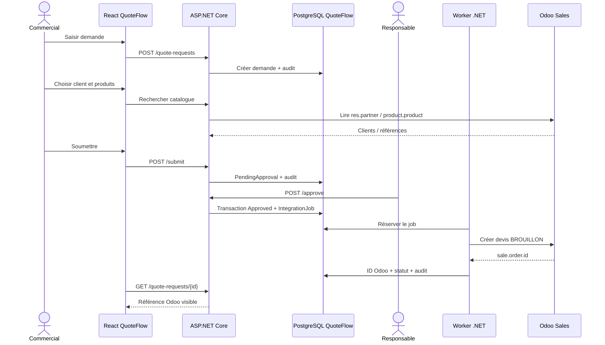

# 08 — Cas d'utilisation et workflows métier

Les cas d'usage sont les contrats fonctionnels de référence. Toute interface ou endpoint doit correspondre à au moins un UC documenté.

## UC-01 — Connexion

**Acteurs** : commercial, responsable, administrateur. **Précondition** : compte existant et actif.

1. L'utilisateur saisit ses identifiants dans React.
2. ASP.NET Core Identity vérifie les identifiants et établit la session sécurisée.
3. React lit `/api/auth/me`, affiche le rôle et les routes accessibles.

**Alternatives** : mauvais mot de passe → message non révélateur; session expirée → 401 et retour connexion; compte désactivé → accès refusé. **Postcondition** : aucun secret de session exposé à du code non nécessaire; le rôle serveur prévaut.

## UC-02 — Création d'une demande

**Acteur** : commercial. **Précondition** : session valide.

1. L'utilisateur ouvre « Nouvelle demande », colle ou saisit le texte client.
2. L'API valide taille du texte et identité de l'utilisateur.
3. La demande est persistée en `Received`, avec propriétaire et événement « créée ».
4. React affiche son détail.

**Exceptions** : texte vide/invalide → 400; session expirée → 401; indisponibilité PostgreSQL → erreur sans succès supposé.

## UC-03 — Sélection du client Odoo

**Acteur** : propriétaire de la demande éditable.

1. Il recherche le client par nom/email dans QuoteFlow.
2. Le backend appelle l'API Odoo en lecture, limite et filtre les résultats.
3. Il sélectionne l'ID de `res.partner` correct.
4. Le backend sauvegarde l'ID sur la demande.

**Exceptions** : aucun résultat → afficher recherche vide, jamais créer automatiquement un client; Odoo hors ligne → état d'erreur et possibilité de reprendre.

## UC-04 — Résolution des produits et constitution des lignes

**Acteur** : propriétaire de la demande éditable.

1. L'utilisateur extrait manuellement les libellés et quantités du texte (MVP).
2. Il recherche les produits Odoo par code interne ou nom.
3. Il choisit la référence correcte pour chaque ligne.
4. L'API vérifie produit, quantité > 0, caractère vendable et statut éditable.
5. L'utilisateur confirme explicitement chaque association.

**Exceptions** : résultat ambigu → choisir manuellement; produit inactif/non vendable → non sélectionnable; quantité négative → rejetée. **Aucune génération automatique d'un prix.**

## UC-05 — Soumettre pour approbation

**Acteur** : commercial propriétaire. **Précondition** : client connu, au moins une ligne confirmée.

1. Le commercial consulte le récapitulatif.
2. Il clique « Soumettre ».
3. Le backend revalide le contenu et transitionne vers `PendingApproval`.
4. Une entrée d'audit enregistre l'auteur et la date.

**Exceptions** : absence de client/ligne → 422; répétition → 409; autre propriétaire → 403.

## UC-06 — Approuver / rejeter

**Acteur** : responsable distinct du propriétaire. **Précondition** : `PendingApproval`.

1. Le responsable ouvre la liste des demandes en attente.
2. Il consulte texte, client, lignes, références et contexte tarifaire Odoo.
3a. Il approuve : l'API passe à `Approved`, écrit un événement et un `IntegrationJob` atomiquement.
3b. Il rejette : saisit un motif obligatoire, état `Rejected`, et l'auteur peut corriger.

**Exceptions** : auto-approbation → 403; statut périmé → 409; motif de rejet vide → 422; deux validations concurrentes → une seule autorisée.

## UC-07 — Créer le devis brouillon dans Odoo

**Acteur** : worker backend. **Précondition** : demande `Approved`, job actif unique, références vérifiées.

1. Le worker réclame le job persisté de façon exclusive.
2. Il vérifie l'absence de devis lié et vérifie/réconcilie la référence externe.
3. Il récupère les informations nécessaires via API Odoo et prépare les lignes.
4. Il appelle Odoo pour créer `sale.order` au stade **brouillon**.
5. Il vérifie la réponse, persiste ID externe, état `OdooDraftCreated` et événement.
6. React affiche la référence.

**Exceptions** : 401/403 Odoo → configuration à corriger; produit changé → nouvelle revue requise; timeout ambigu → `NeedsReconciliation`, pas de retry automatique; réponse confirmant commande → incident bloquant.

## UC-08 — Voir les demandes et leur historique

**Acteur** : commercial (les siennes), responsable (périmètre commun), admin (logs techniques seulement).

1. La liste paginée affiche statut, dates, client, propriétaire autorisé.
2. Le détail affiche lignes, événements horodatés, dernier état d'intégration.

**Exceptions** : autre propriétaire → 403/404; ressource introuvable → 404. Aucune donnée confidentielle dans les logs techniques par défaut.

## UC-09 — Administration / reprise après erreur

**Acteur** : admin. **Précondition** : erreur d'intégration détectée.

1. L'admin examine code d'erreur, correlation ID, tentative et référence commerciale.
2. Il vérifie dans Odoo si un devis existe déjà.
3. Il autorise une reprise contrôlée **ou** attache le devis retrouvé, en journalisant la décision.

**Exceptions** : demande déjà liée à un devis → interdire seconde création; Odoo indisponible → maintenir en attente. Les secrets ne doivent pas être affichés.

## UC-10 — Extension future : extraction IA

**Acteur** : commercial; assistant IA local. **Hors MVP.**

1. L'utilisateur soumet le texte à l'assistant.
2. `IQuoteExtractionService` propose noms, quantités, confiance éventuelle.
3. Le backend valide le schéma JSON; le commercial confirme les produits réels issus d'Odoo.
4. Seule la confirmation humaine crée des lignes exploitables.

**Exception** : sortie invalide/inventée → ignorer l'extraction et revenir au formulaire manuel.

## Workflow de bout en bout

**Notation :** la séquence est nominale ; les cas de panne et timeout sont traités en UC-07/UC-09.
