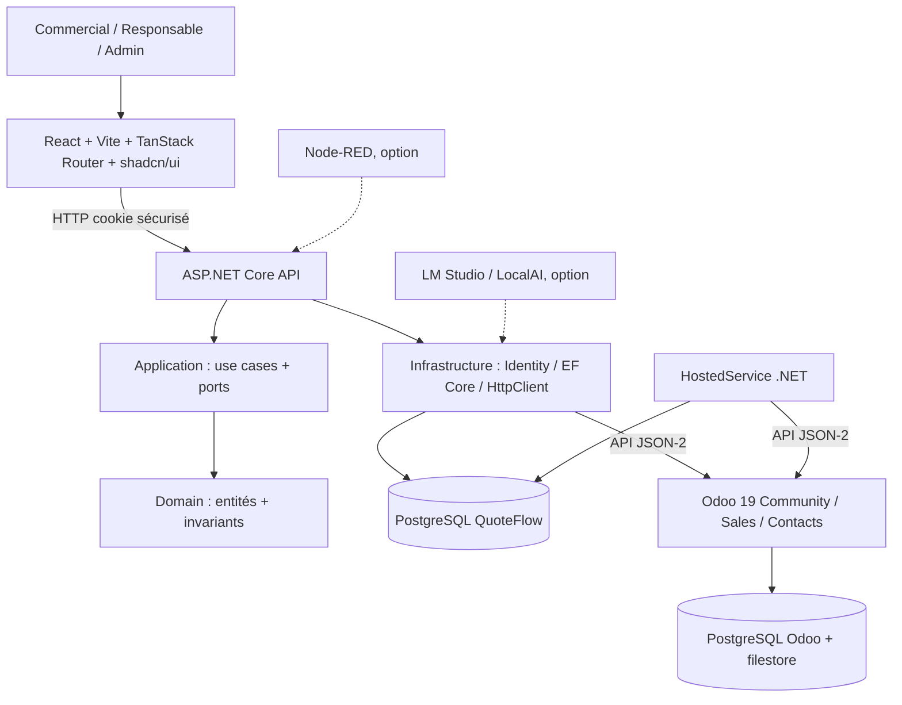

# 09 — Architecture système, données, intégrations et sécurité

## 1. Architecture logique

**Architecture choisie : monolithe modulaire ASP.NET Core + React existant + PostgreSQL dédié + Odoo Community 19.** Un seul backend déployable, pas de microservices. Le serveur .NET concentre le métier; React n'exécute pas les règles d'approbation.



**Attention au schéma** : les dépendances métier sont orientées vers Domain; `API` référence `Infrastructure` **uniquement pour la composition DI**. `Application` définit les interfaces qu'Infrastructure implémente. Le worker peut être hébergé dans le même processus ASP.NET Core au début.

## 2. Dépôt cible

```text
QuoteFlow/
  AGENTS.md
  GEMINI.md
  README.md
  docs/
  infra/
    compose.yaml            # présent ; ne pas écraser
    .env                    # local, jamais versionné
    .env.example
  src/                      # template React existant, situé à la racine
    components/             # réutiliser shadcn et les layouts
    features/               # auth, quote-requests, approvals, odoo-catalog
    routes/                 # TanStack Router, ne pas remplacer
  backend/                  # à créer au Sprint 2, absent aujourd'hui
    QuoteFlow.sln
    src/
      QuoteFlow.Domain/
      QuoteFlow.Application/
      QuoteFlow.Infrastructure/
      QuoteFlow.Api/
    tests/
      QuoteFlow.Domain.Tests/
      QuoteFlow.Application.Tests/
      QuoteFlow.Api.IntegrationTests/
```

**Pas de deuxième routeur**, deuxième bibliothèque UI, second fournisseur d'auth, ni architecture CQRS/mediator obligatoire pour la première version.

## 3. Responsabilité des couches .NET

| Couche | Contenu | Interdiction principale |
|---|---|---|
| Domain | `QuoteRequest`, `QuoteRequestItem`, transitions, invariants | EF Core, HTTP, Odoo, UI |
| Application | UC, DTO, ports IQuoteRequestRepository, IOdooCatalogGateway, IOdooQuotationGateway, job orchestration | SDK Odoo concret, dépendance au Web |
| Infrastructure | EF Core/Npgsql, Identity, `HttpClient` Odoo, jobs persistés, implémentations | Règles métier cachées dans controllers |
| Api | Auth, endpoints, validation d'entrée, réponses ProblemDetails, configuration | Accès SQL ou Odoo dans controllers |
| React | Pages, composants, filtres, formulaires, TanStack Query, TanStack Router | Accès direct à Odoo ou clés API serveur |

## 4. Données QuoteFlow (minimum)

| Table | Champs essentiels | Contraintes |
|---|---|---|
| Identity (`AspNet*`) | UserId, rôles, hashes / security stamps | Index Identity; pas d'auth mock |
| QuoteRequests | Id UUID, OwnerUserId, CustomerOdooId?, RawText, Status, Version, OdooQuotationId?, CreatedAt, UpdatedAt | Index (Owner,Status), version de concurrence, unique OdooQuotationId quand non null |
| QuoteRequestItems | Id UUID, QuoteRequestId, OdooProductId?, RawLabel, Quantity decimal, Confirmed, Ordinal | FK, Quantity > 0, ordre stable |
| QuoteRequestEvents | Id UUID, QuoteRequestId, ActorUserId?, EventType, Reason?, OccurredAt | Append-only logique (pas de modification après création) |
| IntegrationJobs | Id UUID, QuoteRequestId, Kind, JobStatus, Attempts, NextAttemptAt?, CorrelationId, ExternalBusinessKey, LastErrorCode? | Un job de création actif par demande; état de réconciliation |

**Pourquoi ne pas dupliquer `Products`/`Customers` ?** Le catalogue et les clients restent sous Odoo; on ne persiste que les références externes nécessaires et les données minimales utiles à l'audit. Prévoir pagination et recherche côté Odoo.

**Concurrence** : numéro `Version` ou champ PostgreSQL approprié et vérification pour empêcher double approbation ou édition concurrente. **Transactions** : soumission / approbation / job créés localement dans PostgreSQL; jamais supposer une transaction unique PostgreSQL↔Odoo.

## 5. Contrats REST internes (proposition)

Préfixe `/api`, réponse JSON, erreurs normalisées avec `ProblemDetails`, validation serveur obligatoire.

| Méthode | Endpoint | Permission | Cas d'usage |
|---|---|---|---|
| POST | `/api/auth/login` | Public | UC-01 |
| POST | `/api/auth/logout` | Authentifié | UC-01 |
| GET | `/api/auth/me` | Authentifié | UC-01 |
| GET | `/api/quote-requests?page=1&pageSize=20` | Commercial (filtré), Responsable | UC-08 |
| POST | `/api/quote-requests` | Commercial, Responsable | UC-02 |
| GET | `/api/quote-requests/{id}` | Propriétaire / Responsable | UC-08 |
| PUT | `/api/quote-requests/{id}/customer` | Propriétaire + éditable | UC-03 |
| PUT | `/api/quote-requests/{id}/items` | Propriétaire + éditable | UC-04 |
| POST | `/api/quote-requests/{id}/submit` | Propriétaire | UC-05 |
| POST | `/api/quote-requests/{id}/approve` | Responsable non auteur | UC-06 |
| POST | `/api/quote-requests/{id}/reject` | Responsable non auteur | UC-06 |
| GET | `/api/quote-requests/{id}/history` | Propriétaire / Responsable | UC-08 |
| GET | `/api/quote-requests/{id}/integration` | Propriétaire / Responsable | UC-08 |
| GET | `/api/odoo/customers?search=` | Commercial, Responsable | UC-03 |
| GET | `/api/odoo/products?search=` | Commercial, Responsable | UC-04 |
| GET | `/api/admin/integration-jobs` | Admin | UC-09 |

**Aucun endpoint public `POST /odoo/quotations`** n'est prévu. Le job d'intégration n'est déclenché qu'après l'approbation métier.

## 6. Intégration Odoo 19 : contrat et décisions de sécurité

- Odoo est exécuté localement en Community 19, modules Ventes et Contacts activés. Nom de la base : `quoteflow_odoo_dev`.
- Contrat cible : API JSON-2 (`/json/2/{model}/{method}`), avec clé API d'un compte de service et en-tête de sélection de base si requis. **Valider avec Postman sur l'instance réelle avant d'écrire l'adapter**.
- Modèles attendus : `res.partner` (client), `product.product` (article vendable), `sale.order` et `sale.order.line` (devis/lignes). Les champs exacts et la façon de créer des lignes doivent être **explorés et vérifiés** avec `/doc` ou tests contrôlés, sans les inventer.
- Ne pas exposer de clé Odoo au navigateur. Pas de connexion SQL directe aux tables Odoo.
- Sprints techniques : lire 3 clients, 10 produits et créer **un brouillon de test** via Postman dans le laboratoire Odoo (Sprint 1), puis seulement plus tard implémenter la création **après approbation** dans QuoteFlow (Sprint 5).
- Ne pas fabriquer localement les prix/taxes définitifs. La tarification et le calcul final restent dans Odoo; vérifier avec le devis manuel S00001.

### Idempotence — solution MVP défendable

1. `Approve` écrit `Approved` + un `IntegrationJob` de façon atomique; contrainte unique évite deux jobs actifs pour la même demande.
2. Le worker réserve le job, recherche un devis déjà connu pour la `ExternalBusinessKey` métier QuoteFlow, puis décide de créer ou non.
3. Après réponse positive, il persiste l'ID Odoo avec contrainte locale d'unicité.
4. Si timeout ou réponse incertaine après appel d'écriture : statut technique `NeedsReconciliation`, **pas de retry automatique de création**.
5. Un administrateur vérifie si Odoo possède déjà le devis, puis rattache ou relance prudemment. Une clé métier sur `client_order_ref` facilite la recherche mais **ne garantit pas l'unicité dans Odoo**.
6. Une idempotence stricte automatisée nécessite une garantie côté Odoo (ex. module personnalisé ajoutant une contrainte unique) ; **hors MVP**, à évaluer selon la recette.

## 7. Authentification et exposition réseau

- Utiliser **ASP.NET Core Identity** avec session par cookie `HttpOnly`, `Secure` hors HTTP local, configuration `SameSite` adaptée.
- Pour simplifier le développement, configurer un proxy de développement Vite `/api` vers ASP.NET Core et éviter la duplication des origines dans le navigateur.
- Les actions d'écriture authentifiées par cookie exigent une **protection CSRF** adaptée; valider comportement `401/403` indépendamment de React.
- CORS limité aux origines utilisées; HTTPS pour tout hébergement non local.
- Rôles dans Identity + vérification de propriété et d'état dans Application.
- Compte Admin d'initialisation créé via procédure explicite d'environnement, **pas de mot de passe hardcodé**.
- Ne jamais versionner `.env`, clés API, mots de passe, ni enregistrer les prompts client en logs techniques.

## 8. Observabilité, pannes et sauvegarde

- `ProblemDetails` cohérent, code erreur métier distinct des erreurs Odoo.
- Journal de traitement avec correlation ID, ID demande, type d'échec, tentatives et état de réconciliation.
- Timeout et limite de concurrence de requêtes Odoo, pas de retries sans vérification pour les mutations.
- Sauvegarder séparément les bases **et le filestore Odoo**; `docker compose down -v` interdit sans sauvegarde explicite et validation humaine.

## 9. Extensions ultérieures

Node-RED comme orchestrateur de rappels; IA derrière `IQuoteExtractionService` dans Application et adapter dans Infrastructure. Le modèle ne crée pas de produits Odoo ni n'approuve ou ne chiffre un devis.
