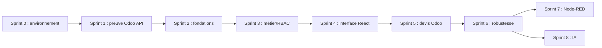

# 10 — Backlog projet découpé en sprints (solo + agents)

## Principe d'exécution

Un sprint est une **étape validable**, pas une durée fixe. Un ticket = un objectif, un périmètre, des tests, une preuve. On privilégie : (1) faisabilité ERP; (2) domaine; (3) auth/RBAC; (4) UI; (5) intégration; (6) robustesse; (7) automatisation; (8) IA.

## Feuille de route

| Sprint | But métier/technique | Tickets ordonnés | Validation manuelle / livrable |
|---|---|---|---|
| **S0 — Environnement** | Odoo, Docker, société, jeu d'essai | T0.1 Compose sain; T0.2 compte/base/modules; T0.3 clients/produits; T0.4 devis de référence; T0.5 redémarrage/persistance | S00001 brouillon: HT 21 200 DH, TVA 4 240 DH, TTC 25 440 DH; `docker compose ps`; réouverture après redémarrage |
| **S1 — Contrat Odoo** | Valider l'API avant le backend | T1.1 compte de service; T1.2 disponibilité/authentification JSON-2; T1.3 lire clients; T1.4 lire produits; T1.5 créer un devis d'essai distinct via API après autorisation; T1.6 archiver les preuves expurgées | HTTP 200 lecture, devis brouillon dans l'interface Odoo, aucune commande confirmée |
| **S2 — Architecture et données** | Fondations sans métier UI | T2.1 Git/solution + références entre couches; T2.2 entités + transitions; T2.3 EF Core + migration; T2.4 tests domaine; T2.5 audit template frontend existant (lecture seule) | `dotnet build`, `dotnet test`, migration PostgreSQL; diagrammes et diff relus |
| **S3 — Authentification et métier** | API QuoteFlow fonctionnelle et sécurisée | T3.1 Identity + 3 comptes de test; T3.2 politiques roles/ownership; T3.3 créer/voir demande; T3.4 choisir client/lignes; T3.5 submit/reject/approve + historique; T3.6 tests API 401/403/409/422 | Postman: commercial ne peut approuver; manager non auteur approuve; accès autre propriétaire refusé |
| **S4 — React existant** | Transformer Shadcn Admin en app métier | T4.1 routes/navigation TanStack; T4.2 retirer fausse auth; T4.3 écran demandes; T4.4 formulaire + recherche Odoo; T4.5 écran d'approbation + statut; T4.6 responsive/tests UI | Workflow via navigateur; `npm run build/lint/test` selon scripts dispo; pas de données démo affichées comme vraies |
| **S5 — E2E Odoo** | Demande approuvée → devis réel | T5.1 adapter Odoo typé; T5.2 mapper client/produits; T5.3 job de création initial; T5.4 persister référence; T5.5 recette intégrée | Une demande approuvée crée **un seul brouillon** visible dans Odoo et référencé dans QuoteFlow |
| **S6 — Robustesse** | Reprise, qualité, traçabilité | T6.1 réservation atomique jobs; T6.2 timeout + reconciliation; T6.3 logs / healthcheck; T6.4 tests de panne/doublon; T6.5 sauvegarde et documentation | Couper Odoo puis reprendre : aucune création double non détectée; preuves de tests |
| **S7 — Automatisation optionnelle** | Notifications et rappels | T7.1 environnement Node-RED local; T7.2 notifications internes safe; T7.3 tests | Rappel d'une demande en attente, sans accès direct à Odoo pour créer devis |
| **S8 — IA optionnelle** | Extraction assistée du texte | T8.1 port `IQuoteExtractionService`; T8.2 adapter LM Studio ou LocalAI; T8.3 sortie JSON stricte; T8.4 tests 20 demandes | Taux de propositions correctes mesuré; correction humaine toujours nécessaire |

## Dépendances et ordre de travail

En pratique, l'audit **sans modification** du frontend peut avoir lieu pendant S1/S2. Il ne doit pas détourner l'effort principal des tests Odoo.

## Sprint 1 — tickets détaillés

Les étapes, prérequis, requêtes exploratoires, contrôles Postman et critères de T1.1 à T1.6 sont maintenus dans [`SPRINT-01-ODOO-API.md`](SPRINT-01-ODOO-API.md). Le devis de test est une action externe : ne l'exécuter qu'après accord explicite, uniquement dans Odoo de développement et après découverte du contrat réel de l'instance.

## Definition of Ready (avant donner à Codex)

1. Ticket sélectionné et dépendances terminées.
2. Fichiers/domaines autorisés identifiés.
3. Exigences FR, BR et UC référencées.
4. Critères d'acceptation et commandes de tests connus.
5. Risques externes et secrets identifiés; aucune action sur la base sans accord.

## Definition of Done (ticket)

- Diff limité, lisible; build et tests exécutés ou limites explicitement rapportées.
- Comportements 401/403/409/422 et invariants applicables couverts.
- Vérifications manuelles effectuées par le propriétaire du projet pour les flux métier.
- Documentation/code cohérents; aucune dépendance superflue.
- Pas de secret, pas de modification destructive de conteneurs ou des données.
- Commit Git traçable; preuves d'exécution ou captures consignées dans compte rendu de sprint.

## Garde-fous pour projet solo

Chaque ticket doit tenir en une revue humaine raisonnable; découper si plusieurs domaines (auth, ERP, UI, infra) sont modifiés simultanément. **Pas deux agents en écriture sur les mêmes fichiers.** Codex implémente; Gemini relit en lecture seule.
